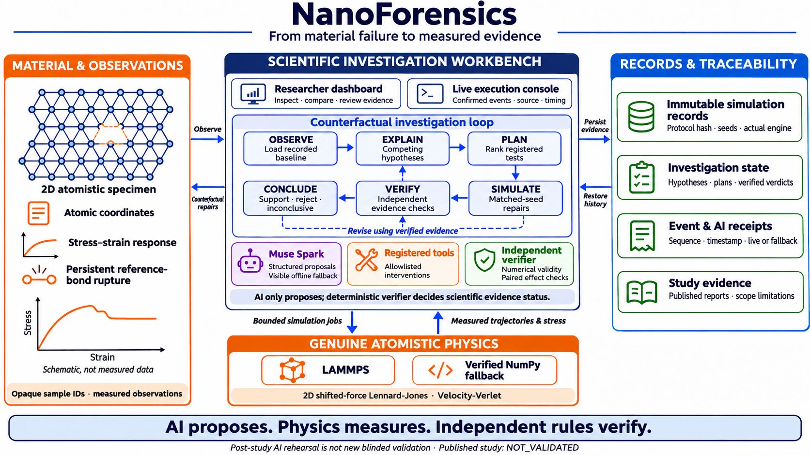
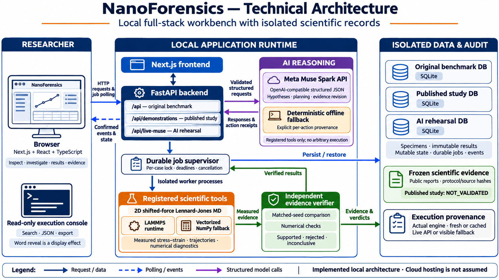

# NanoForensics

> **AI proposes. Physics measures. Independent rules verify.**

[](#why-nanoforensics)
[](#where-ai-fits)
[](#real-physics-independent-verification)
[](#technical-architecture)
[](#what-the-evidence-actually-shows)

**An AI-assisted workbench for investigating why a simulated material breaks.**

NanoForensics compares competing explanations, tests controlled changes with genuine atomistic simulations, and checks whether the measured evidence supports each explanation. Researchers can follow the entire investigation, from the original sample to the final evidence trail.

Built for the **Meta Global AI Developer Hackathon**, under **Push the Frontier**, exploring AI for materials science and scientific discovery.



[Try it locally](#run-locally) · [Demo walkthrough](#try-the-investigation) · [Architecture](#technical-architecture) · [Evidence](#what-the-evidence-actually-shows) · [Detailed project guide](detail.md)

## Why NanoForensics?

A simulation can show a material breaking. Understanding **why** it broke requires another step: changing a suspected cause and comparing what happens.

Did missing atoms inside the sample matter? Did the edge shape matter? Could loading speed or temperature explain the response? An explanation becomes useful when it leads to a test that can distinguish it from an alternative.

NanoForensics organizes that process:

```text
Inspect the recorded sample
          ↓
Propose competing explanations
          ↓
Rank registered experiments
          ↓
Run matched-seed counterfactual simulations
          ↓
Independently verify measurements
          ↓
Revise explanations → conclude or remain inconclusive
```

**The model's confidence does not decide the scientific verdict.** Numerical checks and measured comparisons determine what the evidence supports.

## What you can do

- **Inspect a sample:** explore atomic configurations and stress–strain responses.
- **Run a full investigation:** generate explanations, plan tests, simulate changes, and review verified outcomes.
- **Explore step by step:** inspect suggestions and choose individual registered experiments.
- **Follow execution:** watch a terminal with confirmed events, stage progress, timing, and execution sources.
- **Inspect provenance:** distinguish live model calls, rule-based fallback, fresh computations, and saved simulation reuse.
- **Review and export evidence:** examine measured effects, numerical checks, original event JSON, and complete logs.

## Try the investigation

After [starting the application](#run-locally), open **http://127.0.0.1:3000**.

### 1. Choose a workspace

| Workspace | What it contains | How to use it |
|---|---|---|
| **Original samples** | Four preserved opaque benchmark cases | Inspect the original experiments and their inconclusive findings. |
| **Published study** | Separate preregistered specimens and recorded scientific findings | Explore saved results without model inference. |
| **AI investigation** | An isolated AI workspace initialized from public study samples | Run a post-study rehearsal with live Muse Spark or explicit fallback. |

The workspaces use separate SQLite databases. A rehearsal does not rewrite the published study's decisions.

### 2. Inspect DEMO_501

Select **AI investigation → DEMO_501**. Inspect its atomic structure and original stretching response. This is a small **2D reduced-unit Lennard-Jones computational testbed**, not a calibrated engineering material.

### 3. Start the investigation

Click **Run full investigation**. If a previous investigation is complete, use **View results** to inspect it or **Investigate again** to start another cycle.

The system compares two registered changes: **Restore missing interior atoms** and **Restore missing edge atoms**. The selected experiment order can vary with model output.

To inspect each stage yourself, open **Explore step by step**, choose **Suggest possible causes**, and execute individual tests.

### 4. Follow the execution console

Under the scientific loop, **Technical log** opens a single terminal with an **Initialize → Finish job** sidebar.

- New confirmed text appears word by word; this is a display effect, not provider token streaming.
- **Auto-follow** follows new output. Scrolling upward pauses it; **Jump to latest** resumes it.
- Search messages and full event payloads, expand original JSON, copy events, or download the complete history.
- Check the actual **live/fallback** and **fresh/cached** labels. A successful calculation is separate from a supported explanation.

No fabricated timestep percentage or completion estimate is shown. Actual compute and provider timing vary.

### 5. Compare results and inspect evidence

Open **Results** to compare the original and changed simulations. Open **Evidence** for independent verdicts, AI action receipts, simulation identifiers, seeds/replay labels, and protocol hashes.

For the **published DEMO_501 record**, the interior repair increased fracture strain by approximately **47.85%**; the competing edge repair changed it by approximately **−0.61%**. These are case-specific measured findings, not a promised result for every sample or future run.

Finish by opening **Study scope and this sample**. A successful case does not establish that the full study passed.

For a longer presentation, use the [DEMO_501 presenter walkthrough](docs/live-muse/DEMO_501_WALKTHROUGH.md).

## Run locally

### Requirements

- **Python 3.11+**; Python 3.13 is the repository's Makefile default.
- **Node.js 22.18+ recommended**, with npm, for the application and native TypeScript UI tests. Next.js itself requires Node 20.9+.
- **Optional LAMMPS**, available as `lmp` or `lmp_serial`. Its shifted-force support is verified at runtime; otherwise the application visibly selects NumPy.
- **Optional Meta API credentials** for live model inference. Without them, the application uses a labeled deterministic fallback.

### Install

```sh
git clone https://github.com/0xPkhatri/NanoForensics.git
cd NanoForensics

python3 -m venv .venv
.venv/bin/python -m pip install -r requirements.txt
npm --prefix frontend ci
cp .env.example .env
```

If `.env` already exists, retain it and update only the settings you need.

### Start the backend

```sh
make backend
```

Startup calibrates the physics runtime if needed. An empty published-study database is restored from the checksummed public evidence bundle; the AI workspace is initialized separately. Existing data are preserved. You can explore those workspaces without regenerating the scientific study.

To populate the **Original samples** workspace on a clean installation, run the following separately, before starting investigations:

```sh
make calibrate
make data
```

This performs genuine physics computation and can take time. It preserves existing specimens. New exploratory benchmarks should use a separately named `NANO_DB`.

### Start the frontend

In another terminal:

```sh
make frontend
```

| Service | Local address |
|---|---|
| Dashboard | http://127.0.0.1:3000 |
| Backend | http://127.0.0.1:8000 |
| Interactive API documentation | http://127.0.0.1:8000/docs |

The Next.js server proxies API requests to FastAPI. For a production-mode local frontend, run `make build`, then `npm --prefix frontend start`.

## Where AI fits

Muse Spark generates structured hypotheses, contributes experiment-planning judgments, and revises explanations after evidence arrives. The controller executes only registered deterministic tools. It never runs model-generated shell commands or arbitrary Python.

| Responsibility | Owner |
|---|---|
| Competing explanations and subjective scores | Muse Spark, or explicitly labeled deterministic fallback |
| Planning judgments | Structured model output or fallback; fixed backend utility calculation |
| Allowed actions, budgets, and execution | Deterministic investigation controller |
| Atomic trajectories and physical measurements | Verified LAMMPS or NumPy engine |
| Numerical validity and evidence verdicts | Independent deterministic verifier |
| Interpretation and review | Researcher, with complete recorded provenance |

Configure `.env` using the [Meta API documentation](https://dev.meta.ai/docs/overview):

```dotenv
META_MUSE_BASE_URL=https://api.meta.ai/v1
META_MUSE_MODEL=muse-spark-1.3
META_MUSE_API_KEY=your_key_here
```

The startup probe checks connectivity and structured-response support. **Every relevant action must independently succeed** to receive `LIVE_MUSE_SPARK_API`; unavailable credentials, provider failures, or rejected outputs produce visible `OFFLINE_HEURISTIC_FALLBACK` receipts.

A recorded live integration rehearsal completed hypotheses, planning, and evidence-based revisions with six freshly executed counterfactual MD replays. Later rehearsals explicitly reused immutable MD. Both successes and mixed failures are retained in the [integration report](docs/live-muse/INTEGRATION_REPORT.md). This is integration evidence on a published sample, not new blind discovery; current provider access must be verified again when demonstrating.

## Technical architecture



The current implementation runs locally; cloud hosting is not assumed.

| Component | Technology | Responsibility |
|---|---|---|
| Workbench | Next.js, React, TypeScript, CSS, Plotly.js | Sample inspection, controls, plots, execution console, and evidence review |
| API | FastAPI, Pydantic | Typed requests, validated actions, state, and job/event endpoints |
| Job execution | Durable supervisor and bounded subprocesses | Per-case locks, deadlines, cancellation, and restart recovery |
| AI reasoning | Meta Muse Spark via OpenAI-compatible API | Structured hypotheses, planning, and evidence-citing revisions |
| Physics | LAMMPS / vectorized NumPy | Genuine 2D shifted-force Lennard-Jones trajectories |
| Verification | Independent Python analysis | Numerical checks, paired comparisons, and scientific verdicts |
| Persistence | Separate SQLite workspaces | Specimens, immutable results, mutable investigations, jobs, and events |
| Published evidence | Checksummed public bundle and reports | Reproducible records and preserved study scope |

The frontend polls real job events. Events retain sequence numbers, timestamps, phases, statuses, structured data, and provenance. No real shell is exposed through the terminal.

### Configuration

| Variable | Default / example | Purpose |
|---|---|---|
| `META_MUSE_BASE_URL` | `https://api.meta.ai/v1` | Structured model API base |
| `META_MUSE_MODEL` | `muse-spark-1.3` | Configured model identifier |
| `META_MUSE_API_KEY` | Empty | Credentials for live inference; keep private |
| `META_MUSE_TIMEOUT_SEC` | `30` | Provider timeout; capped at 60 seconds |
| `NANO_DB` | `runtime/nanoforensics.db` | Original benchmark workspace |
| `NANO_DEMONSTRATION_DB` | `runtime/demonstration/v3/study.db` | Published-study workspace |
| `NANO_LIVE_MUSE_DB` | `runtime/live-muse/rehearsal.db` | Separate AI investigation workspace |
| `NANO_RUN_TIMEOUT` | `30` | Per-simulation timeout, seconds |
| `NANO_JOB_TIMEOUT` | `120` | Job timeout, seconds |
| `NANO_BUDGET` | `1800` | Investigation compute budget, seconds |
| `NANO_ADMIN_TOKEN` | Empty | Token for guarded administrative benchmark operations |

Results, failed executions, and raw seed records persist. Reset clears mutable investigation progress; it does not erase immutable simulations or force cached physics to recompute. Recompute policy is explicit and recorded. See the [detailed guide](detail.md) for APIs and storage behavior.

## Real physics, independent verification

- **Actual interatomic mechanics:** shifted-force 12–6 Lennard-Jones potential with cutoff 2.5σ, integrated trajectories, and virial stress. Curves and fracture metrics are not synthesized from specimen names.
- **Verified engine choice:** LAMMPS potential output is checked; unavailable or unsupported configurations fall back visibly to NumPy. Identical seed integers do not imply identical stochastic trajectories across engines.
- **Reference-relative fracture:** persistent severed reference bonds and a post-peak stress drop are evaluated together. An unbroken sample at the end of the measurement horizon is censored, with `failure_strain=null`.
- **Paired evidence:** controlled changes are compared using matched seeds/replay labels and measured numerical diagnostics. Execution failure, censoring, and scientific inconclusiveness remain distinct.
- **Blind boundaries:** original public case IDs are opaque. Privileged preparation labels and pristine site mappings stay outside live investigator inputs and tools.

Definitions, stress conventions, engine comparisons, audit findings, and limitations are documented in the [detailed project guide](detail.md), [scientific audit](docs/SCIENTIFIC_FINDINGS.md), and [engine comparison](docs/ENGINE_COMPARISON.json).

## What the evidence actually shows

**The complete published study is `NOT_VALIDATED`.** It did not meet every preset criterion. The UI retains that status even when one specimen supports a tested explanation.

| Evidence set | Recorded outcome | Scope |
|---|---|---|
| Original four-case benchmark | No unique diagnosis for any case across the three compared methods | No discovery or superiority claim follows from these cases. |
| Held-out `DEMO_501` | Interior repair +47.85%; competing repair −0.61% | Met the registered case-level distinction. |
| Held-out `DEMO_502` | Boundary repair +10.79%, below the fixed 18% criterion | Inconclusive; did not validate the repair. |
| Held-out `DEMO_503` | Correct no-cause negative control | Does not override the failed full-study criterion. |
| Muse Spark rehearsal | Recorded live hypotheses, planning, and revisions | Post-study integration; not a new blinded validation. |

V3 is an **athermal deterministic reference**. Three exact replay labels are not independent thermal observations and do not establish population confidence intervals. Published runs took approximately 14.41–15.99 seconds each on the measured host; the loading horizon was preserved despite exceeding the runtime target.

Read the [complete study report](docs/demonstration/v3/STUDY_REPORT.md), [original benchmark report](docs/BENCHMARK_REPORT.md), and [live-model evidence](docs/live-muse/INTEGRATION_REPORT.md). Earlier negative development studies and failed/mixed rehearsals remain recorded. Frozen results and thresholds must not be tuned after seeing held-out outcomes.

## Reproduce and test

```sh
# Physics, verifier, investigation, workspace and event regressions
make test

# Frontend formatting, rendering, reveal and auto-follow logic
npm --prefix frontend run test:ui
npm --prefix frontend run typecheck
make build

# Live HTTP regression with real servers and isolated databases
make e2e

# Original benchmark evaluation
make evaluate
```

E2E owns ports 3000/8000 while running; stop the local development servers first. It disables provider credentials, uses isolated database copies, and exercises fresh MD, cancellation, restart recovery, and workspace isolation. The frontend has no configured standalone lint script.

Latest recorded terminal/sidebar checks: **36 UI tests**, TypeScript and production build passed. The full-stack gate passed **11 tests**. Browser automation later failed before navigation, so the latest terminal's visual/mobile and real-browser interaction checks remain unverified. These counts are recorded checks, not a substitute for rerunning tests in your environment. See [executed results](docs/TEST_RESULTS.md) and the [terminal implementation report](docs/TECHNICAL_TERMINAL.md).

### Verify live inference separately

With valid provider credentials:

```sh
# Actual model calls plus fresh counterfactual MD
make verify-live-muse

# Actual model calls with explicitly reused genuine simulation records
.venv/bin/python -m scripts.verify_live_muse --reuse-md
```

Use a separate `NANO_LIVE_MUSE_DB` to preserve an existing rehearsal. Avoid running CLI and HTTP investigations concurrently against the same rehearsal database.

### Inspect and replay published evidence

```sh
.venv/bin/python -m demonstrations.verify_preservation
.venv/bin/python -c 'from demonstrations.lock_development import verify_lock; verify_lock()'
.venv/bin/python -m demonstrations.replay_published
```

Replay leaves stored evidence unchanged. Exact replay was measured with the installed LAMMPS version; other versions and engines may differ. Scientific study generation and scoring are explicit, preregistered workflows; see the [study registration](demonstrations/v3/PREREGISTRATION.md) before attempting new study runs.

## Project map

```text
NanoForensics/
├── frontend/src/       Dashboard, execution terminal, plots, typed API client
├── backend/
│   ├── agents/         Structured Muse Spark client and hypothesis/planning logic
│   ├── api/            Original REST API, durable jobs and workers
│   ├── simulation/     LAMMPS and NumPy atomistic engines
│   ├── analysis/       Measurements, comparisons and independent verifier
│   ├── storage/        Original SQLite persistence
│   ├── demonstration/  Separate published-study API and tools
│   └── live_muse/      Isolated AI rehearsal API and investigator
├── benchmarks/         Original case generation and evaluation
├── demonstrations/     Preregistered studies, scoring and reproduction
├── tests/              Physics, investigation and full-stack checks
├── scripts/            E2E lifecycle and live-model acceptance
├── docs/               Reports, architecture images, evidence and continuity
└── detail.md           Full beginner-readable project guide
```

## Documentation

- [Complete project guide](detail.md)
- [Scientific workflow and technical diagrams](docs/architecture/README.md)
- [Four-minute presenter walkthrough](docs/live-muse/DEMO_501_WALKTHROUGH.md)
- [Published study and limitations](docs/demonstration/v3/STUDY_REPORT.md)
- [Live Muse integration and retained failures](docs/live-muse/INTEGRATION_REPORT.md)
- [Scientific audit](docs/SCIENTIFIC_FINDINGS.md)
- [Technical terminal behavior and verification](docs/TECHNICAL_TERMINAL.md)
- [Build plan](docs/IMPLEMENTATION_PLAN.md) · [Project state](docs/PROJECT_STATE.md) · [Handoff](docs/HANDOFF.md)
- [Contributor and scientific integrity instructions](AGENTS.md)

## Research scope

NanoForensics is a small 2D computational research demonstrator. Its findings do not establish predictive accuracy for real engineering materials or safety-critical decisions. Model scores are subjective; small matched ensembles are descriptive. The project preserves negative findings and uncertainty as part of its scientific record.
