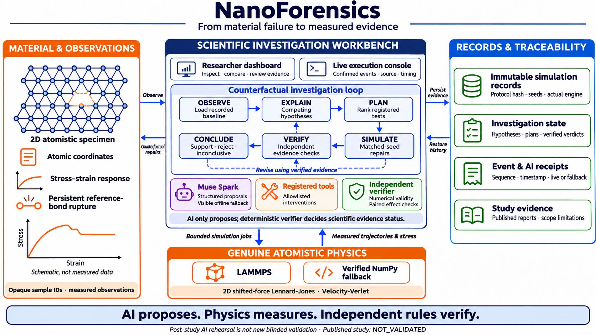
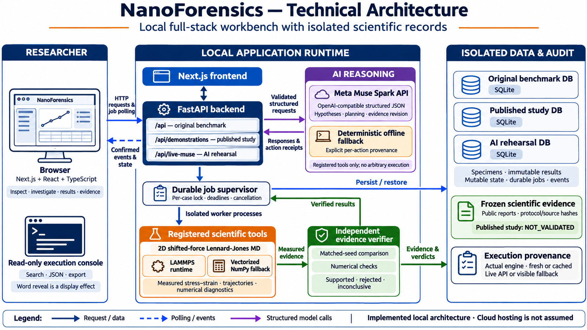

# NanoForensics — the complete project explained in simple words

This document explains the project from the beginning. You do not need to know artificial intelligence, molecular dynamics, or the code before reading it.

The description reflects the implemented project and its recorded results as of **5 November 2026**. Recorded test results and successful API calls describe what was verified at that time; they do not guarantee that an external service will always be available.

For a shorter introduction and quick setup, start with [README.md](README.md). This guide goes further into the current interface, scientific methods, code, storage, and limitations.

Recent changes covered here include the simpler three-view dashboard, investigation controls near sample selection, a single live terminal with word-by-word output and a stage sidebar, architecture diagrams, and the presentation-first README. These changes do not alter the registered physics or evidence rules.

Quick navigation: [Dashboard and controls](#18-what-you-see-in-the-dashboard) · [Architecture](#19-how-the-application-is-connected) · [File map](#21-where-the-files-are-and-what-each-important-file-does) · [Run locally](#25-how-to-run-the-project) · [DEMO_501 walkthrough](#27-how-to-understand-or-present-demo_501-yourself) · [Testing](#28-how-testing-and-reproducibility-work) · [Troubleshooting](#30-common-questions-and-problems)

## 1. What is NanoForensics?

NanoForensics is a small scientific investigation application.

It creates or loads a computer model of a material made of atoms, stretches that model until it may break, and investigates why it failed.

It asks questions such as:

- Did an empty space inside the material make it fail earlier?
- Did a damaged edge make it fail earlier?
- Did the speed of stretching change its behavior?
- Did temperature or random atomic motion make the outcome uncertain?
- If we change one suspected cause, does the material actually behave differently?

The project combines a visual dashboard, an AI investigator, a real atom-motion simulator, and a separate evidence checker.

**Its main objective is to make material-failure investigations testable, understandable, and auditable.**

“Auditable” means someone can inspect the inputs, operations, measurements, and reasoning behind a conclusion.

The project was developed for the Meta Global AI Developer Hackathon, under the theme of scientific discovery and physical systems.

## 2. A simple everyday comparison

Imagine a chair breaks.

One person says, “The leg was weak.” Another says, “The joint was loose.” Looking at the broken chair may not settle the question.

A stronger investigation would make comparable copies:

1. Keep one copy unchanged.
2. Strengthen only the leg in another copy.
3. Repair only the joint in a third copy.
4. Apply the same loading conditions.
5. Measure what changes.

NanoForensics follows this idea with simulated atoms.

The important difference is that the repair is actually applied to the computer specimen and the physics is run again. The AI does not simply write a convincing explanation.

## 3. What the project can currently claim

There are three different kinds of achievement here:

| Question | Current answer |
|---|---|
| Does the software work as an application? | The recorded backend tests, frontend build, TypeScript check, and full-stack tests passed. |
| Has the project made real Meta Muse Spark API calls? | Yes. Hypothesis generation, experiment planning, and evidence-based belief revision were verified with actual responses. |
| Did every scientific demonstration case meet the declared success criteria? | No. The complete demonstration study remains `NOT_VALIDATED`. |
| Did one demonstration specimen show a meaningful repair difference? | Yes. `DEMO_501` met its registered case-level checks. |
| Can this predict failure of a real aircraft, implant, or engineering alloy? | That has not been established. |

The project uses a small, two-dimensional model material. It is a scientific computing testbed, not a validated industrial material-prediction service.

## 4. The three workspaces in the dashboard

The **Workspace** selector contains three choices. Current display names are **Original samples**, **Published study**, and **AI investigation**. Older reports may call them the original benchmark, preregistered demonstration, and Live Muse Spark rehearsal respectively. These refer to the same three isolated workspaces.

### 4.1 Original samples — the frozen benchmark

This contains four original specimens:

- `CASE_ALPHA`
- `CASE_BETA`
- `CASE_GAMMA`
- `CASE_DELTA`

“Frozen” means the saved benchmark inputs and results are preserved. We do not replace them with easier examples after seeing an unfavorable result.

All four original investigations remain inconclusive. This is part of the actual scientific record.

These specimens test whether an investigator can reach a diagnosis without being given the answer in the specimen's name or hidden preparation information.

### 4.2 Published study — the preregistered demonstration

This is a separate study designed after the original scientific audit.

“Preregistered” means the team wrote down the simulation conditions, hypotheses, success rules, and evaluation procedure before generating that study's results.

Three versions exist:

- **V1:** failed to establish the intended distinction during development.
- **V2:** failed additional physical temperature validation during development.
- **V3:** the final athermal study, with partial scientific success.

The V1 and V2 held-out sets were never generated. Their negative development results were retained.

V3 has six public specimens:

| Partition | Cases | Purpose |
|---|---|---|
| Development | `DEMO_401`, `DEMO_402`, `DEMO_403` | Develop and check the analysis before opening the held-out portion. |
| Held-out | `DEMO_501`, `DEMO_502`, `DEMO_503` | Evaluate the fixed procedure on the registered unseen geometry shift. |

“Held-out” means those specimens were kept unavailable until the development code and predictions were locked.

The frozen study uses registered deterministic tools. Its original investigation is not presented as a live AI investigation.

### 4.3 AI investigation — the live/fallback rehearsal

This is a third, separate workspace.

It lets the actual Meta Muse Spark model generate hypotheses, plan experiments, and revise its beliefs using the published specimen inputs and newly completed experiment evidence in that rehearsal.

It has its own database and job state. Running it does not rewrite the published scientific study.

Because the study is already published, this workspace is a **post-study AI integration demonstration**. It is not a new blinded scientific evaluation.

The same physical simulator and independent scientific rules still apply.

## 5. Important words, in everyday language

| Word | Simple meaning in this project |
|---|---|
| Atom | One particle in the simulated material. |
| Lattice | The regular starting arrangement of atoms. |
| Specimen | One particular piece of simulated material. |
| Defect | A change in the atomic arrangement, such as missing atoms. |
| Baseline | The original specimen and its measured behavior before an intervention. |
| Hypothesis | A possible explanation that still needs testing. |
| Intervention | A controlled physical change made to test an explanation. |
| Counterfactual | A “what would happen if we changed this?” experiment. |
| Strain | How much the specimen stretches compared with its original length. |
| Stress | A measure of the internal mechanical loading calculated from atomic forces and motion. |
| Failure strain | The amount of stretch when the registered fracture rule is first satisfied. |
| Peak stress | The highest measured stress in a loading curve. |
| Toughness | Here, an area-under-the-curve measure of work absorbed during the recorded loading. |
| Seed | A starting number used to reproduce a random-number sequence. |
| Replicate | Another run used to check variation or repeatability. |
| Athermal | With a target temperature of zero in the model. Loading and damping still produce motion. |
| Numerical validity | Whether the computation stayed within its declared stability and consistency limits. |
| Censored run | A valid run that ended before a confirmed fracture was observed. |
| Provenance | The record of where an output came from and how it was produced. |
| Hash | A digital fingerprint used to identify data or detect changes. |
| API | A structured way for one program to request something from another program. |

## 6. The complete investigation, step by step

### Step 1: Observe the specimen

The application loads the visible starting coordinates, baseline stress–strain curve, atomic snapshots, and permitted physical settings.

A case ID is just an opaque name. The live investigator does not open the private preparation/scoring files to learn the intended answer.

### Step 2: Propose competing explanations

The investigator produces more than one explanation.

For example:

- An internal missing-atom component may weaken the load-bearing network.
- A boundary-connected missing-atom component may concentrate stress at an edge.

A hypothesis includes a proposed experiment, a prediction, a subjective score, and missing evidence.

In the live workspace, Muse Spark writes these through a bounded JSON response. In fallback mode, deterministic Python rules provide clearly labeled alternatives.

### Step 3: Plan experiments

The planner compares allowed interventions using expected information, cost, and risk.

The basic idea is:

```text
usefulness = expected information - cost penalty - risk
```

The exact normalization differs between the original planner and the registered demonstration/rehearsal planner. The application records the proposal values so the ordering can be inspected.

In the live rehearsal, the model supplies information-gain estimates, risk estimates, and explanations. The backend computes the utility. The model cannot change the registered physical protocol.

### Step 4: Apply an allowed physical change

A deterministic tool edits the observed geometry or, where allowed in the original system, a bounded physical control setting.

The study and live rehearsal allow only the two registered geometric repairs. They do not allow the model to choose arbitrary coordinates or new loading conditions.

### Step 5: Run molecular dynamics

The simulation worker calculates atom forces and updates atom motion through many small time steps.

The baseline and intervention use matched seed labels and comparable settings. An unchanged immutable baseline can be reused with its provenance recorded.

### Step 6: Check the measurements independently

The verifier checks numerical validity, matched inputs, actual fracture observations, effect size, repeatability, and the fixed scientific thresholds.

Invalid computation cannot be used as proof of a mechanism.

### Step 7: Revise beliefs

The investigator receives the completed experimental evidence.

In the live rehearsal, a new actual model call produces revised subjective scores, predictions, and explanations referring to completed experiment IDs.

The AI can change its opinion. It cannot change the verifier's scientific status.

### Step 8: Conclude and export

The application stores the conclusion and complete trace, then shows the evidence in the dashboard. The user can export the investigation as JSON.

## 7. What the AI does—and what produces the physical measurements

Muse Spark is used for scientific reasoning tasks:

- Suggest competing mechanisms.
- Explain what observations support or challenge them.
- Predict what an allowed repair might change.
- Estimate information gain and risk.
- Explain experiment priorities.
- Revise subjective beliefs after receiving measurements.

The physical engine produces the forces, atomic motion, energies, stresses, and trajectories.

Separate deterministic analysis produces fracture measurements and scientific verdicts.

A useful way to read the system is:

```text
AI:        “Here are two possible explanations and tests.”
Tools:     “Here is the actual allowed physical edit.”
Simulator: “Here is what the atoms did.”
Verifier:  “Here is what this evidence can support.”
AI:        “Here is how the evidence changes my reasoning.”
```

No raw shell command or arbitrary Python program written by the model is executed.

## 8. How the atom simulation works

### 8.1 Start with an atomic sheet

The specimen starts as rows of atoms in a hexagonal arrangement.

The model is two-dimensional: atom positions and movement are restricted to a plane.

The final demonstration starts from a 16 × 20 lattice, which has 320 sites before defects remove atoms. Defective specimens therefore contain fewer atoms.

### 8.2 Calculate interactions between atoms

Atoms interact using the shifted-force Lennard-Jones potential, abbreviated **SFLJ**.

In simple terms:

- At very short distances, the interaction strongly pushes atoms apart.
- At suitable larger distances, the interaction attracts them.
- Beyond the cutoff distance, the interaction is zero.

The shifted-force form makes both the potential energy and force approach zero smoothly at the cutoff. This avoids an abrupt force jump there.

The cutoff is 2.5 times the model's distance unit, sigma.

The implementation uses analytical pair-force calculations. It does not draw a desired stress curve from a polynomial, a case-name lookup, or an invented set of points.

### 8.3 Prepare the specimen

Before pulling it, the system:

1. Relaxes the coordinates to reduce large residual forces.
2. Prepares the target temperature using the documented integration and thermostat procedure.
3. Runs an unstrained, unthermostatted energy-conservation check called NVE.
4. Records the reference geometry and reference neighboring atoms.

These preparation steps matter. A badly prepared specimen could produce a misleading “fracture” that is really an invalid computation.

### 8.4 Pull with grips

Atoms near the top and bottom act as grips.

The grips move apart in opposite directions. The middle atoms move in response to the forces. The sides are free rather than wrapped around periodically.

Engineering strain is calculated from the change in grip separation divided by its reference separation.

The strain rate means strain per unit of physical model time. It is not confused with displacement per integration step.

### 8.5 Advance time

The engine takes many small time steps.

Force calculations and trajectory integration determine how the atoms move. The NumPy path uses vectorized pair calculations and Velocity-Verlet-based integration with a documented thermostat splitting. The LAMMPS loading path uses its own documented integrator and thermostat implementation.

Those engine details are recorded. Giving both engines the same integer seed does not guarantee identical random trajectories.

### 8.6 Measure the response

The program records atomic positions, energies, stress, coordination, and bond-loss information during loading.

Stress comes from atomic motion and pair-force contributions, called the virial. The code uses a disclosed tensile-positive sign convention and an effective area based on nominal width and current grip separation, with unit thickness.

It does not multiply the curve by an arbitrary factor to create a convincing failure.

## 9. Why there are two physics engines

| Engine | What it is | How it is selected |
|---|---|---|
| LAMMPS | An external molecular-dynamics program that executes a generated input script. | Used when an installed binary and an acceptable SFLJ interaction implementation are verified. |
| NumPy fallback | The project's vectorized Python/NumPy atom-motion engine. | Used when a suitable LAMMPS path is unavailable. |

The runner checks for `lmp` or `lmp_serial`.

Finding a binary is not enough. The program checks its interaction capability and force/energy behavior. It does not call ordinary `lj/cut` a shifted-force potential.

There is also a testable table-generation route with measured interpolation errors.

Cross-engine checks begin with simple force and energy comparisons. Broader trajectory comparisons use the same physical conventions and disclose uncertainty. A small comparison is not proof that both engines are interchangeable for every case.

The dashboard and saved results identify the engine actually used. The recorded live acceptance used LAMMPS.

## 10. How the program decides that fracture happened

The application does not declare fracture simply because an atom has few neighbors. Atoms at a free edge naturally have fewer neighbors.

Instead, it compares against the reference geometry recorded after preparation.

The registered detection includes:

1. Find reference neighboring atoms.
2. Track reference bonds that become stretched beyond the rupture distance.
3. Identify atoms with sufficient severed reference bonds and net neighbor loss.
4. Build connected clusters using the reference-neighbor graph, excluding grips.
5. Require a cluster of at least four actively ruptured atoms to persist across three measurements.
6. Examine the complete, fixed-smoothed stress curve retrospectively.
7. Require the post-peak stress to fall to 65% or less of the positive global peak over the confirmation window.

The fracture strain is assigned to the first qualifying measurement, confirmed by later measurements.

If the run ends without these conditions, failure strain stays empty (`null`). The program does not use the final strain as an invented fracture value.

## 11. What the result labels mean

There are several different kinds of labels. They answer different questions.

### Physical run outcomes

| Label | Meaning |
|---|---|
| `FRACTURED` | The registered fracture rule was satisfied. |
| `NOT_FRACTURED_WITHIN_HORIZON` | No confirmed fracture was observed before the planned run ended. |
| `EXECUTION_FAILED` | A computation or numerical-validity problem prevents valid scientific use of that run. |

### Hypothesis verdicts

| Label | Meaning |
|---|---|
| `PENDING` | A scientific verdict has not been established. |
| `SUPPORTED` | The evidence meets the fixed support rules for that tested hypothesis. |
| `REJECTED` | The evidence meets the specific rejection rule; this is not a universal proof that the mechanism can never matter. |
| `INCONCLUSIVE` | Valid evidence does not establish the required answer, or the overall investigation lacks decisive evidence. |

### Other statuses

- `NO_APPLICABLE_EDIT`: the geometric tool found no eligible target. It does not invent a repair.
- `MATCHED_SEED_VALIDATION_FAILED`: expected paired seed records are missing, duplicated, or inconsistent.
- `INSUFFICIENT_UNCENSORED_PAIRS`: enough comparable confirmed failures are unavailable.
- `NOT_VALIDATED`: the complete study did not pass every registered study-level requirement.
- `CONCLUDED`: an individual investigation reached its applicable conclusion. This does not mean the entire study or a real engineering material has been validated.

A failed computation is not scientific evidence against a hypothesis. A missing repair target is also not experimental proof that every related mechanism is false.

## 12. How comparisons and scientific checks work

The program compares a baseline and an intervention under controlled conditions.

For the original benchmark, the normal matched seeds are 42, 137, and 271. V3 uses separate registered replay labels.

The comparison retains individual results rather than saving only an average.

Important measurements include:

- Failure-strain change: how much later or earlier fracture happened.
- Recovery percentage: that change divided by baseline failure strain, expressed as a percentage.
- Peak-stress change: how the highest stress changed.
- Paired variation: how the baseline-to-intervention differences vary across matched runs.
- CV: spread relative to the average, expressed as a percentage.
- SNR: effect size compared with measured variation and a fixed strain floor.

For V3 at target T=0, repeated seed labels are numerical replay checks at the same geometry. They do not supply independent thermal samples. Its SNR is a contrast relative to the fixed strain floor, not a population-confidence statistic.

Some key fixed rules are:

| Check | Recorded rule |
|---|---|
| Pre-load NVE relative energy drift | Less than 0.001. |
| Maximum force | Less than 10,000 in the model's force units. |
| Maximum step displacement | Less than 0.1 in the model's distance units. |
| Raw kinetic-temperature error measure | Less than 0.35 under its disclosed normalization. At T=0 the existing 0.01 scale is used. |
| Main failure-strain support route | At least 18% recovery, SNR at least 2.5, CV at most 12%, and complete valid comparable results. |
| V3 dominant-repair comparison | At least 10 percentage points above the competing repair, with contrast SNR at least 2.5. |
| V3 finer-step check | Failure-strain difference at most 0.01, peak-stress difference at most 5%, and matching dominant decisions. |

The main verifier also has a predeclared rate-normalization stress criterion. It requires a sufficient peak-stress reduction with adequate stress SNR and non-decreasing failure strain. This is not an excuse to call any lower peak stress a successful ductility repair.

Rules are applied to actual evidence. They are not changed to make a named case pass.

## 13. The DEMO_501 example, with real recorded numbers

The baseline failure strain was **0.0815**.

That means its grip separation had increased by about **8.15%** when the registered fracture condition was met.

Two repairs were tested:

| Condition | Failure strain | Change relative to the baseline |
|---|---:|---:|
| Baseline | 0.0815 | Reference condition. |
| Interior repair | 0.1205 | About +47.85% recovery. |
| Boundary repair | 0.0810 | About −0.61% recovery. |

The interior repair increased the recorded failure strain from roughly 8.15% stretch to 12.05% stretch.

The **47.85%** figure is the relative increase in failure strain. It does not mean the material stretched by an additional 47.85 percentage points.

For this model, geometry, and protocol, the interior repair had the larger supported effect. That does not establish an exclusive cause for every aspect of its fracture.

In the first verified live AI loop, the model tested the boundary repair first, saw its small negative result, and later increased its interior-mechanism score after the interior result arrived.

A later grounded rehearsal chose a different order. The AI's order and subjective scores can vary; the physical evidence and verifier rules remain fixed.

## 14. Why the complete study did not pass

The held-out results were:

| Case | Measured result | Study interpretation |
|---|---|---|
| `DEMO_501` | Interior repair +47.85%; competing boundary repair −0.61%. | Correct case-level distinction; registered case checks passed. |
| `DEMO_502` | Boundary repair +10.79%; interior repair −11.62%. | Inconclusive. The positive recovery did not reach the fixed 18% requirement. |
| `DEMO_503` | Pristine negative control, with no eligible geometric repair. | Correct negative control; no cause identified. |

A negative control is an example where the system should avoid claiming a repair mechanism without evidence.

All applicable held-out arms passed the recorded numerical checks, exact replay checks, and finer-timestep checks. These numerical successes do not cancel the failed scientific recovery criterion for `DEMO_502`.

Because the study required every registered held-out case to meet its requirements, its final status remains **`NOT_VALIDATED`**.

This is why “all software tests passed” and “the scientific study did not fully validate” can both be true.

## 15. What happened with the original four benchmark cases

The original benchmark remains preserved, including its unsuccessful diagnoses.

The scientific audit investigated those failures with additional separate controls:

- **ALPHA:** the important failure was the driven-temperature validity gate. The audit did not establish a diverging integrator as the cause. Slower-loading controls improved numerical validity, but did not replace the frozen results or establish the intended diagnosis.
- **BETA:** geometry reconstruction could restore the missing-site geometry, but an expanded nine-pair audit found only about +0.457% failure-strain recovery. A geometrically successful edit does not guarantee a mechanically important repair.
- **GAMMA:** reducing the loading rate reduced failure strain in the recorded comparison. The negative recovery was preserved rather than rewritten into the expected positive story.
- **DELTA:** the frozen investigation did not establish a unique evidence-supported cause.

The fixed-checklist, one-shot, and original investigator comparisons all retained four `NO_DECISION` outcomes. The project does not claim superiority from these original cases.

## 16. Live AI, fallback, cached physics, and fresh physics

These are separate ideas.

### Live AI

`LIVE_MUSE_SPARK_API` means the relevant operation received an actual provider response and passed the required local validation.

The record includes model identity, host, latency, provider response ID, request/response fingerprints, and token counts when the provider supplies them.

A startup connection probe alone is insufficient.

### Fallback AI

`OFFLINE_HEURISTIC_FALLBACK` means that operation used deterministic fallback behavior because live inference was unavailable or invalid.

Possible reasons include missing configuration, a timeout, incomplete JSON, the wrong model identity, or an invalid action/evidence response.

One investigation can have a mixture of successful live actions and fallback actions. Each receipt must be inspected separately.

### Fresh physics

The simulator actually runs another trajectory for the requested counterfactual. The audit records that it was newly computed.

### Cached physics

The program reuses an immutable result identified by its input, protocol, engine, and seed information.

Caching saves time. It is valid when the reused record corresponds to the required conditions, and reuse is disclosed.

A fresh live model call can reason over cached genuine MD. A fallback investigator can also request fresh genuine MD. Neither of those combinations should be mislabeled.

## 17. What was actually verified with Muse Spark

The recorded integration used the configured model `muse-spark-1.3` through `https://api.meta.ai/v1`.

The first successful full loop included:

1. A structured hypothesis-generation call.
2. A separate structured planning call.
3. Six fresh counterfactual MD replay executions: three for each repair.
4. Two evidence-based revision calls, one after each completed intervention.
5. The independent verifier's conclusion.

That full loop took about **121.95 seconds** on the recorded host.

One model mistake was found: an initial explanation placed the boundary defect on the reported crack side, although the visible geometry put that defect on the other side. The deterministic tool still edited the measured geometry correctly.

The transcript was retained. Explicit coordinate-derived component positions were then added to the model observations.

A subsequent rehearsal had an invalid revision and visibly fell back. That run is retained as `NOT_VERIFIED`.

After strengthening citation constraints and receipts, a final grounded rehearsal passed all four live model actions while explicitly reusing immutable MD.

This history shows why a live model response is not automatically a correct scientific explanation.

## 18. What you see in the dashboard

The page uses plain-language labels and three main views: **Investigate**, **Results**, and **Evidence**. You select a workspace and sample near the top, then choose how to investigate.

### 18.1 Page order and navigation

The main order is:

```text
Workspace → Sample → Investigation controls
                         ↓
Current operation / cancellation
                         ↓
The scientific loop · tests may repeat
                         ↓
Investigation console
                         ↓
Investigate / Results / Evidence content
                         ↓
Study scope and this sample
```

The console appears when a request starts or confirmed event history is available. It sits below the scientific loop rather than above it. The Evidence view retains the console for later inspection.

| Part of the page | What it helps you understand |
|---|---|
| Header and main navigation | Actual engine/AI telemetry and the Investigate, Results, Evidence views. |
| Workspace and sample selectors | Which isolated dataset and sample you are viewing. |
| Investigation controls | Full automatic investigation or step-by-step exploration. |
| Current operation banner | Confirmed operation message, elapsed job time, and cancellation while running. |
| Scientific loop | The high-level investigation stages; experiments and verification may repeat. |
| Investigation console | Confirmed operation history, technical details, and execution sources. |
| Atomic viewer and trajectory controls | Recorded coordinates, coordination, bond loss, per-atom stress, and saved frames. |
| Stress–strain plot | Original and selected changed-sample curves from genuine MD. |
| Explanation cards | Possible causes, subjective scores, predictions, and evidence statuses. |
| Test planner | Registered interventions, priority/rationale, cost/risk, and Run this test controls. |
| Results | Measured comparisons and independent verdicts, including insufficient evidence. |
| Evidence | AI action receipts, event history, simulation records, and full-report inspection/export. |
| Follow an investigation guide | Six shortcuts to relevant sections; these navigate and do not run experiments. |
| Study scope and this sample | Full-study NOT_VALIDATED status, case scope, registration, and Read the study link near the bottom. |

The V3 replay envelope is not a population uncertainty band. Stored evidence is identified as stored rather than portrayed as current computation.

### 18.2 What the investigation controls do

| Control | What happens |
|---|---|
| **Run full investigation** | Begins a new cycle: explanations, ranked tests, physical comparisons, independent checks, revisions, and conclusion. |
| **View results** | Replaces the primary action when the investigation has concluded or is inconclusive; opens existing results. |
| **Investigate again** | Available beside View results; requests a new cycle. Valid saved physical records may still be reused according to execution policy. |
| **Explore step by step** | Expands the manual workflow controls. |
| **Suggest possible causes** | Generates explanations/plans using recorded baseline observations; it does not itself request a new repair trajectory. It replaces mutable explanation/progress state for that cycle. |
| **Run this test** | Executes a registered individual experiment and checks its evidence. |
| **Cancel current job** | Requests actual termination of the current worker and its descendants. |
| **Reset investigation** | After confirmation, clears mutable investigation progress in this workspace. It retains immutable simulation results and published scientific evidence. |

Reset does not force LAMMPS to recompute a cached simulation. A new investigation cycle and new physical computation are different actions. Whether fresh or cached physics actually supplied a result is recorded explicitly.

### 18.3 Overview and Technical log

**Technical log opens by default**, including when you start a new investigation. **Overview** remains available for readable event cards and explanatory summaries.

Both show the same backend-confirmed nine-stage sidebar:

1. Initialize.
2. Inspect the sample.
3. Suggest explanations.
4. Plan tests.
5. Run simulations.
6. Check evidence.
7. Update explanations.
8. Conclude.
9. Finish job.

On desktop, stages sit on the left and output on the right. Smaller screens place a compact stage grid above the output. An active stage has a loading indicator, completed stages have checkmarks, and waiting/failed/stopped states have text as well as symbols. Reduced-motion preferences are respected.

Simulation, verification, and revision status refer to the current comparison. A completed first repair does not mark a later repair's checks complete. Likewise, finishing one replicate does not finish the entire comparison. Earlier results stay in the chronological log.

### 18.4 The single execution terminal

Technical log uses one dark, internally scrolling console, titled **NanoForensics / Execution Console**. Its header uses actual sample, engine, job status, and elapsed-time records. A selected engine is qualified until returned results confirm the executed engine.

Events appear as continuous lines with elapsed time, a short tag, a message, and relevant scientific details. Events retain their original sequence, timestamps, and payloads. Adjacent events may receive an experiment heading/indentation; this changes presentation only and does not merge or reorder records.

| Example tag | Meaning |
|---|---|
| `AI` | AI-related event; live versus fallback is stated explicitly. |
| `PLAN` | Registered test planning information. |
| `RUN` | Execution has started or is in progress. |
| `CACHE` | A saved immutable simulation was loaded. |
| `OK` | Successful execution; not proof of a causal explanation. |
| `CHECK` | Numerical-check information. |
| `RESULT` | Measured comparison and independent evidence verdict. |
| `ERR` / `STOP` | Failed or stopped work. |

These are semantic examples, not a fabricated transcript. Color supplements the label: green for execution success/checks, blue for running/information, amber for fallback/warnings, red for failure, and gray for ordinary information. Execution success, numerical validity, evidence support, and full-study validation remain separate.

An active simulation panel can show the selected engine, baseline/test role, replicate label, and real elapsed time. If per-timestep progress is unavailable, it says it is waiting for the simulation result. It does not invent completion percentages, ETAs, or trajectory events.

### 18.5 Word-by-word output and automatic following

Newly confirmed messages and their metrics reveal word by word, in event order. A single display queue handles a batch of events; a large backlog catches up in bounded word batches. The backend may have already confirmed an event before all its text appears.

This is **a display effect over completed event payloads**, not live provider token streaming or streamed LAMMPS stdout. The terminal states this distinction. Existing completed history appears immediately. Reduced-motion mode, searching, opening details, or leaving the terminal view make the relevant confirmed text available immediately rather than waiting through animation.

**Auto-follow** scrolls the internal terminal as revealed text grows and new events arrive. Manual upward scrolling pauses following so you can read. **Jump to latest** clears the matches-only filter and resumes following the output. Intentional return to the bottom may also resume following. Expansion and search state persist across polling and view switches for the same job.

### 18.6 Search, JSON details, copying, and downloads

- **Search logs:** searches both readable messages and full structured event data. Matching text is highlighted. Use the arrow buttons, Enter, or Shift+Enter to navigate. A match found only in a payload can open that event's details.
- **Matches only:** filters the displayed rows; it never deletes history.
- **Expand an event:** reveals syntax-highlighted original event JSON, collapsed by default. Long payloads remain accessible without truncation. JSON is complete relative to the API payload already parsed by JavaScript; it cannot restore numerical precision lost before that point.
- **Copy event JSON:** copies one complete original payload.
- **Copy logs / Copy visible logs:** copies readable timestamps, sequence numbers, status labels, messages, and metrics for the relevant rows. Feedback waits for the clipboard operation to succeed or fail.
- **Download JSON:** exports the complete original job/activity event history, including events hidden by filtering.
- **Download .log:** exports the complete readable transcript.
- **Expand console:** opens an in-page expanded view, with Escape/focus handling. This is not a real command terminal or operating-system fullscreen session.

The Evidence view also offers the complete investigation report and simulation metadata. Job events and report/state exports are related but separate records.

### 18.7 The guide and study scope

The six **Follow an investigation** shortcuts take you to material, explanations, tests, results, evidence, and conclusion. They navigate; they do not start jobs. Use the top controls to request work.

The **Study scope and this sample** disclosure is near the end of the page in the study/AI workspaces. It contains **Full published study: NOT_VALIDATED**, the explanation that not all preset criteria passed, case-level checks, and **Read the study**. The AI workspace additionally explains that this is a post-study rehearsal, not new blinded validation.

For visual and control implementation details, see the [technical terminal report](docs/TECHNICAL_TERMINAL.md). Its latest browser/mobile and real-browser interaction checks remain unverified because the browser automation adapter failed before navigation; passing logic/rendering tests do not replace those checks.

## 19. How the application is connected

### Scientific workflow image



### Implemented technical architecture



These are explanatory diagrams of the implemented local system. The lattice is schematic and the drawn stress plot is explicitly not measured data. The architecture does not assume Google Cloud, Firestore, Pub/Sub, SSE, or WebSockets. Diagram prompts and notes are saved in [docs/architecture](docs/architecture/README.md).


```text
Browser dashboard
       |
       | Structured HTTP requests and job polling
       v
FastAPI backend
       |
       +--> Investigator --> Muse Spark API, or visible fallback
       |
       +--> Registered physical edit tools
       |
       +--> Bounded worker process --> LAMMPS or NumPy MD
       |
       +--> Independent analysis and evidence verifier
       |
       +--> SQLite databases and saved audit records
       |
       v
Dashboard receives progress, measurements, receipts, and conclusions
```

The browser does not run the MD solver. It asks the backend to create a job.

The API responds quickly with a job ID. The browser polls job/state/activity data approximately every 1.2 seconds while a separate worker performs the expensive calculation. After a terminal job status is confirmed, the client refreshes the final event snapshot. Requests belonging to an earlier sample/job are guarded so they do not replace the current view.

This keeps the server responsive while atoms are being simulated.

## 20. Technologies used, explained simply

| Technology | Its role |
|---|---|
| Python | Most backend, simulation, analysis, and scientific-control code. |
| NumPy | Fast calculations on many coordinates and pair interactions at once. |
| SciPy | Scientific helpers such as minimization and spatial calculations. |
| LAMMPS | External engine for genuine atomistic trajectories when available and verified. |
| FastAPI | The backend's HTTP endpoints. |
| Pydantic | Validates structured inputs, outputs, proposals, and AI responses. |
| SQLite | Saves specimens, results, investigation states, and jobs in local database files. |
| Jinja2 | Fills the LAMMPS input template with the run's settings. |
| Next.js and React | Build and display the browser dashboard. The current package uses Next.js 16, within the original 14+ requirement. |
| TypeScript | Checks frontend data types and interfaces. |
| TailwindCSS and CSS | Style the scientific workbench. |
| Plotly.js | Draws interactive mechanical-response plots. |
| HTTPX | Makes backend HTTP requests, including provider requests and integration checks. |
| psutil | Helps inspect, terminate, and clean up worker processes. |
| pytest | Runs the Python test suites. |
| Git | Stores source changes and scientific checkpoints. |

## 21. Where the files are, and what each important file does

Paths below are relative to the repository root. Small `__init__.py` files make Python folders importable; they generally do not contain the main project logic.

### Root files

| File | Purpose |
|---|---|
| `detail.md` | This beginner-friendly explanation. |
| `AGENTS.md` | Build specification, scientific integrity rules, and continuity instructions. |
| `README.md` | Presentation-first overview with badges, diagrams, current demo walkthrough, setup, configuration, evidence scope, and testing. |
| `Makefile` | Short commands for setup, simulation data, tests, build, servers, and live verification. |
| `requirements.txt` | Python dependency list. |
| `.env.example` | Example nonsecret configuration names and documented provider settings. |
| `.env` | Local settings and secret API key. Ignored by Git; do not publish it. |
| `.gitignore` | Lists local/generated/secret files that should not be committed. |
| `pytest.ini` | Test configuration and markers. |

### Backend entry point and data contracts

| File | Purpose |
|---|---|
| `backend/main.py` | Creates the FastAPI application, initializes the three stores, restores empty public study/rehearsal stores, checks engine/provider readiness, and starts job managers. |
| `backend/config.py` | Reads environment settings, original database path, default budgets, and original seed labels. |
| `backend/models/schemas.py` | Defines the shared shape of specimens, runs, snapshots, hypotheses, proposals, verification results, telemetry, jobs requests, and investigation states. |

### Original API and job handling

| File | Purpose |
|---|---|
| `backend/api/routes.py` | Original case, hypothesis, experiment, job, cancellation, immutable-result, and administrative evaluation endpoints. |
| `backend/api/jobs.py` | Durable job supervision, process launching, deadlines, cancellation, crash recovery, and cleanup. |
| `backend/api/job_worker.py` | Runs an original-workspace job inside its worker process. |
| `backend/storage/db.py` | SQLite storage operations for specimens, immutable results, mutable states, and jobs. |

### Original investigator and model access

| File | Purpose |
|---|---|
| `backend/agents/investigator.py` | Coordinates the original observe–hypothesize–experiment–verify–revise loop and registered tools. |
| `backend/agents/muse_agent.py` | Provider configuration/health probe, bounded JSON requests, model/completion checks, usage telemetry, and original structured decisions. |
| `backend/agents/hypothesis_engine.py` | Original deterministic fallback hypotheses and updates from verifier results. |
| `backend/agents/experiment_planner.py` | Original budget-aware proposal scoring and ordering. |

### Simulation files

| File | Purpose |
|---|---|
| `backend/simulation/defect_generator.py` | Builds the lattice, infers visible missing sites, and applies original geometric/protocol transformations. |
| `backend/simulation/numpy_md_fallback.py` | Analytical SFLJ pair interactions, vectorized forces, integration, preparation, and the NumPy simulation path. |
| `backend/simulation/lammps_runner.py` | Detects LAMMPS, validates potential behavior, handles optional tables, prepares/executes runs, and chooses the fallback when needed. |
| `backend/simulation/input_templates/tensile_2d_lj.in.j2` | The generated LAMMPS tensile-test instructions. |
| `backend/simulation/experiment_validator.py` | Checks run validity and numerical consistency. |
| `backend/simulation/worker.py` | Runs a simulation in a bounded subprocess and terminates it when necessary. |

### Analysis files

| File | Purpose |
|---|---|
| `backend/analysis/stress_strain.py` | Stress convention and retrospective fracture detection from the recorded response. |
| `backend/analysis/structure_analysis.py` | Reference neighbors, lost/severed bonds, connected rupture clusters, and localization. |
| `backend/analysis/comparison.py` | Aggregate summaries and paired comparison statistics, including seed/censoring checks. |
| `backend/analysis/evidence_verifier.py` | Independent fixed rules for evidence availability and scientific verdicts. |
| `backend/analysis/force_balance.py` | Cross-checks force moments and virial/boundary contributions. |
| `backend/analysis/thermal_diagnostics.py` | Extra temperature/motion diagnostics used to understand suspicious runs. |

### Registered demonstration runtime

| File | Purpose |
|---|---|
| `backend/demonstration/registration.py` | Loads the active version, verifies its registration fingerprint, and exposes public study status. |
| `backend/demonstration/geometry.py` | Infers missing-site components and reconstructs registered repairs from observable geometry. |
| `backend/demonstration/investigator.py` | The registered deterministic two-repair loop and dominant-effect conclusion. |
| `backend/demonstration/analysis.py` | Registered contrast and deterministic replay checks. |
| `backend/demonstration/convergence.py` | Checks whether the dominant decision remains consistent under timestep refinement. |
| `backend/demonstration/validation.py` | Additional registered physical checks, including open-slot separation and force-moment consistency. |
| `backend/demonstration/storage.py` | Study storage that retains failed runs as evidence instead of silently retrying them away. |
| `backend/demonstration/routes.py` | Separate study API namespace with fixed-protocol intervention restrictions. |
| `backend/demonstration/job_worker.py` | Executes a study job in its worker process. |

### Live Muse rehearsal runtime

| File | Purpose |
|---|---|
| `backend/live_muse/contracts.py` | Strict allowed JSON shapes for model hypotheses, planning choices, and evidence-citing belief updates. |
| `backend/live_muse/inference.py` | Builds visible-data prompts, requests structured responses, constrains evidence IDs, validates attempts, and records receipts/fallback. |
| `backend/live_muse/investigator.py` | Adds live AI reasoning to the unchanged registered physical tools and independent verifier. |
| `backend/live_muse/storage.py` | Selects/initializes the separate rehearsal database and leaves published decisions out of its initial mutable AI state. |
| `backend/live_muse/routes.py` | Separate live-rehearsal endpoints. |
| `backend/live_muse/job_worker.py` | Executes live-workspace jobs. |

### Original benchmarks and audit tools

| File | Purpose |
|---|---|
| `benchmarks/generate_cases.py` | Privileged original benchmark generation using actual MD, with public/private information separated. |
| `benchmarks/calibrate_runtime.py` | Measures host simulation cost and records runtime calibration. |
| `benchmarks/fixed_checklist.py` | Comparator that follows a fixed intervention order. |
| `benchmarks/oneshot_baseline.py` | Comparator that makes a one-shot decision without counterfactual experiments. |
| `benchmarks/evaluate.py` | Freezes comparator decisions, then scores them and writes reports. |
| `benchmarks/validate_engines.py` | Cross-engine force/energy and limited ensemble comparison work. |
| `benchmarks/audit_science.py` | Separate diagnostic experiments for the original scientific failures. |
| `benchmarks/report_scientific_audit.py` | Summarizes the audit's measured evidence. |
| `benchmarks/ground_truth.json` | Private original preparation/scoring records, generated locally and ignored by Git. Live investigation tools do not read it. |

### Demonstration preparation and reproducibility tools

These are research/generation tools, not tools that the live model can freely invoke.

| File or folder | Purpose |
|---|---|
| `demonstrations/active-study.json` | Selects the active registered study version. |
| `demonstrations/registration.json`, `registration.sha256`, `PREREGISTRATION.md` | V1 design, fingerprint, and readable preregistration. |
| `demonstrations/v2/` | V2 design, fingerprint, and preregistration. |
| `demonstrations/v3/` | V3 design, fingerprint, preregistration, and committed development lock. |
| `demonstrations/generate.py` | Generates a registered partition and keeps private preparation assignments separate. |
| `demonstrations/evaluate.py` | Runs/freezes blind decisions and scores registered study outcomes. |
| `demonstrations/lock_development.py` | Records/verifies the scientific source and development-prediction lock required before held-out generation. |
| `demonstrations/refinement.py` | Runs the registered smaller-timestep comparisons. |
| `demonstrations/reproduce.py` | Fresh same-engine numerical reproduction check. |
| `demonstrations/replay_published.py` | Reruns a published trajectory using public inputs without private preparation access. |
| `demonstrations/package_evidence.py` | Packages public specimens/results/states and checksums, excluding private preparation maps. |
| `demonstrations/restore.py` | Restores a checksummed public bundle only into an empty study/rehearsal store. |
| `demonstrations/verify_preservation.py` | Verifies preserved original specimen/result records against their saved fingerprint. |

### Frontend files

| File | Purpose |
|---|---|
| `frontend/src/app/page.tsx` | Main page composition, Investigate/Results/Evidence navigation, guide targets, and study scope. |
| `frontend/src/hooks/useInvestigation.ts` | Sample/workspace loading, actions, durable-job restoration, guarded polling, cancellation, and current event history. |
| `frontend/src/components/WorkspaceSelector.tsx` | Current workspace and sample controls. |
| `frontend/src/components/InvestigationControls.tsx` | Run full investigation, completed-state actions, manual exploration, and reset. |
| `frontend/src/components/CurrentStepBanner.tsx` | Current operation message, elapsed time, and job cancellation. |
| `frontend/src/components/InvestigationSteps.tsx` | High-level scientific loop. |
| `frontend/src/components/InvestigationConsole.tsx` | Default Technical log / Overview tabs, shared nine-stage sidebar and results/evidence actions. |
| `frontend/src/components/ExecutionTerminal.tsx` | Single terminal, search/filter/navigation, copying, full exports and expanded view. |
| `frontend/src/components/TerminalEventRow.tsx` | Continuous event lines and deliberately expanded highlighted original JSON. |
| `frontend/src/hooks/useLogFollow.ts` | Internal auto-follow, resize handling and manual-scroll pause/resume. |
| `frontend/src/hooks/useTerminalReveal.ts` | Ordered word-by-word display queue with immediate/reduced-motion modes. |
| `frontend/src/lib/console-view.ts` | Confirmed events, stage labels, elapsed formatting and current-comparison progress. |
| `frontend/src/lib/console-reveal.ts` | Overview text-reveal session state. |
| `frontend/src/lib/terminal-format.ts` | Safe event formatting/grouping, search highlights, source semantics and exports. |
| `frontend/src/lib/terminal-reveal.ts` | Pure word-boundary and timeline reveal helpers; raw events remain untouched. |
| `frontend/src/lib/log-follow.ts`, `clipboard.ts` | Follow decisions and real clipboard success/failure handling. |
| `frontend/src/lib/presentation.ts`, `investigation-view.ts` | Plain-language labels, workspace definitions and view/result helpers. |
| `frontend/src/components/ResultSummary.tsx` | Plain-language conclusion and measured-result summary. |
| `frontend/src/components/EvidenceTimeline.tsx`, `EvidenceUpdateCard.tsx` | Evidence chronology and experiment updates. |
| `frontend/src/components/HelpPanel.tsx` | Plain-language workflow help. |
| `frontend/src/app/layout.tsx` | Shared application layout. |
| `frontend/src/app/globals.css` | Workbench styling. |
| `frontend/src/components/HeaderBar.tsx` | Engine, AI mode, and budget display. |
| `frontend/src/components/LatticeCanvas.tsx` | Interactive atomic-coordinate viewer. |
| `frontend/src/components/StressStrainPlot.tsx` | Actual MD curves, comparisons, and disclosed spread/envelopes. |
| `frontend/src/components/HypothesisPanel.tsx` | Hypothesis cards and subjective scores. |
| `frontend/src/components/PlannerPanel.tsx` | Ranked intervention table and execution controls. |
| `frontend/src/components/AIActionPanel.tsx` | Per-operation live/fallback receipts and belief changes. |
| `frontend/src/components/DemoWalkthrough.tsx` | Six working navigation shortcuts under Follow an investigation; no experiment is run by a shortcut. |
| `frontend/src/components/AuditReportModal.tsx` | Detailed audit modal and JSON export. |
| `frontend/src/lib/api.ts` | Typed frontend data structures and HTTP helper with a request timeout. |
| `frontend/src/lib/plotly.d.ts` | TypeScript declaration support for Plotly. |
| `frontend/package.json` | Frontend dependencies and development/build/start/typecheck/UI-test commands. |
| `frontend/package-lock.json` | npm's resolved dependency versions. |
| `frontend/next.config.mjs` | Proxies API and public study-evidence requests to the backend. |
| `frontend/tsconfig.json` | TypeScript compiler settings. |
| `frontend/tailwind.config.ts`, `postcss.config.mjs` | CSS build settings. |
| `frontend/next-env.d.ts` | Next.js TypeScript environment declarations. |

### Verification scripts and tests

| File | Purpose |
|---|---|
| `scripts/verify_e2e.sh` | Starts real backend/frontend servers, isolates test databases, runs full-stack tests, and cleans launched processes. |
| `scripts/e2e_servers.py` | Starts/stops the owned server processes used for preview and acceptance. |
| `scripts/verify_live_muse.py` | Actual-provider acceptance for hypotheses, planning, revisions, and genuine MD or explicitly reused MD. |
| `scripts/verify_rehearsal_preservation.py` | Checks frozen Git evidence, the source lock, and all four original/study database tables against local snapshots. |
| `tests/test_physics_and_defects.py` | Analytical forces, potential behavior, conservation, engine checks, and geometric transformations. |
| `tests/test_verifier.py` | Fracture, numerical validity, censoring, and evidence-rule behavior. |
| `tests/test_investigation_loop.py` | Original loop, blindness, provider provenance, storage, and verdict authority. |
| `tests/test_scientific_audit.py` | Regression checks from the original scientific audit. |
| `tests/test_demonstration.py` | Study geometry, registrations, physical checks, contrast, source lock, and isolation. |
| `tests/test_demonstration_public.py` | Public archive restoration and corruption rejection. |
| `tests/test_live_muse.py` | Bounded model outputs, failures, real-MD cache use, citation restrictions, and verifier authority. Provider fixtures here are not proof of live service use. |
| `backend/api/progress.py` | Durable public event schema, allowlisted event emission and consistent job/activity snapshots. |
| `tests/test_console_progress.py` | Real operation event order, provenance and workspace-preserving progress checks. |
| `frontend/tests/console.test.mjs`, `console-reveal.test.mjs` | Stage/current-comparison and Overview reveal logic. |
| `frontend/tests/terminal.test.mjs`, `terminal-render.test.mjs` | Terminal formatting, event order/grouping, search, raw payload/export preservation and rendered states/sidebar. |
| `frontend/tests/terminal-reveal.test.mjs`, `log-follow.test.mjs` | Sequential word reveal, unchanged underlying data and scrolling decisions. |
| `frontend/tests/clipboard.test.mjs`, `presentation.test.mjs` | Clipboard acknowledgment/failure and plain-language presentation logic. |
| `frontend/tests/tsx-loader.mjs` | Test-only TSX loader using the installed TypeScript compiler; no new runtime dependency. |
| `tests/test_e2e_fullstack.py` | Real HTTP jobs, persistence, cancellation, timeouts, crash recovery, dashboard, and workspace isolation. |

### Documentation and evidence folders

| Path | What to read there |
|---|---|
| `docs/IMPLEMENTATION_PLAN.md` | Work plan and completed acceptance tasks. |
| `docs/PROJECT_STATE.md` | Project state and latest verified source checkpoints, including earlier historical stages. |
| `docs/HANDOFF.md` | Resume instructions for another coding agent. |
| `docs/TEST_RESULTS.md` | Commands run and actual pass/failure records. |
| `docs/E2E_LAST_RUN.txt` | Latest saved full-stack test output. |
| `docs/BENCHMARK_REPORT.md` and `.json` | Frozen original benchmark comparison and detailed evidence. |
| `docs/SCIENTIFIC_AUDIT_PLAN.md` | Declared original-audit investigation plan. |
| `docs/SCIENTIFIC_FINDINGS.md` | Measured explanations and limitations from the audit. |
| `docs/science-audit/` | Audit measurements, raw retained runs, and validation evidence. |
| `docs/ENGINE_COMPARISON.json` | Recorded limited cross-engine comparison. |
| `docs/demonstration/` | V1 evidence, preservation fingerprints, and separate original regression reports. |
| `docs/demonstration/v2/` | Retained V2 negative evidence. |
| `docs/demonstration/v3/STUDY_REPORT.md` | Full V3 scientific explanation and partial-success result. |
| `docs/demonstration/v3/` | Development/held-out decisions, scoring, refinement, replay evidence, public bundle, checksums, and validation transcript. |
| `docs/live-muse/INTEGRATION_REPORT.md` | Current live-model implementation, actual calls, errors, failures, and limitations. |
| `docs/live-muse/DEMO_501_WALKTHROUGH.md` | Four-minute presenter script and prepared/fresh-run instructions. |
| `docs/live-muse/` | First successful, mixed-failure, final grounded, and HTTP-worker integration records. |
| `docs/TECHNICAL_TERMINAL.md` | Current terminal/sidebar/reveal behavior, tests and browser-verification limitation. |
| `docs/INVESTIGATION_CONSOLE.md` | Earlier backend console/event implementation and regression record; newer layout is in TECHNICAL_TERMINAL.md. |
| `docs/architecture/` | Scientific workflow and technical architecture PNGs, notes, and image-generation prompts. |
| `docs/archive/` | Earlier retained reports for historical comparison. |

Files ending in `.json` contain structured records. Files ending in `.json.gz` contain compressed structured records. A `.sha256` file contains a fingerprint used to check file integrity.

The current README reflects verified historical live integration. Earlier retained project notes may predate it; consult the dated integration receipts rather than interpreting old prose as current connection status. The frozen scientific study itself still uses its original deterministic procedure.

## 22. What is stored in the databases?

The normal local paths are:

| Database | Purpose |
|---|---|
| `runtime/nanoforensics.db` | Original benchmark/application records. |
| `runtime/demonstration/v3/study.db` | Active registered scientific study. |
| `runtime/live-muse/rehearsal.db` | Separate mutable AI rehearsal. |

Environment settings can point to different database paths.

Each store uses four principal scientific/job tables plus a durable public event table:

| Table | Contents |
|---|---|
| `specimens` | Frozen public specimen description and the serialized simulation input. |
| `results` | Immutable simulation records and their IDs/cache keys. |
| `states` | Current mutable investigation state: hypotheses, proposals, evidence, audit, conclusion. |
| `jobs` | Durable queued/running/completed work records, payloads, process identity, and errors. |
| `job_events` | Ordered, timestamped public console events linked to a job; separate from mutable investigation state. |

An event has `seq`, `job_id`, `timestamp`, `phase`, `status`, `message`, and structured `data`. Event statuses are `started`, `completed`, `failed`, or `skipped`; job statuses are separate. The terminal shows RUNNING/COMPLETED/FAILED/CANCELLED and other recorded stop states without assuming that finishing execution validates a scientific claim. Public event emission excludes credentials, hidden preparation/scoring data and arbitrary raw worker stderr. It is not an unrestricted dump of backend internals.

The main UI restores the latest applicable job for the selected sample. Earlier jobs/events remain stored and can be requested by their job ID; the terminal export covers the selected job's full history, not every job in the database.

Private demonstration preparation maps live under the generator/scorer-owned runtime study directories. They are not needed by the live repair tools.

Database files, temporary runs, logs, Python environments, frontend build output, and credentials are local generated artifacts. Git does not commit the whole `runtime/` folder.

The public evidence bundles under `docs/` let an empty study or rehearsal database be restored without private maps. The original benchmark has its own explicit generation process.

## 23. Important API routes

The frontend normally reaches these through its own `/api` proxy.

| Route | Meaning |
|---|---|
| `GET /api/health` | Backend/engine readiness and connection telemetry. |
| `GET /api/cases` | Original specimens. |
| `GET /api/cases/{case_id}` | One original specimen and its current investigation. |
| `POST /api/cases/{case_id}/hypothesize` | Queue hypothesis generation. |
| `POST /api/cases/{case_id}/experiment` | Queue one validated proposal/intervention. |
| `POST /api/cases/{case_id}/auto-investigate` | Queue the autonomous loop. |
| `POST /api/cases/{case_id}/reset` | Clear that workspace's mutable investigation state when no job owns it. |
| `GET /api/jobs/{job_id}` | Read progress and terminal job status. |
| `GET /api/cases/{case_id}/activity` | Read a consistent job-plus-events snapshot; optional `job_id` selects a retained job. |
| `POST /api/jobs/{job_id}/cancel` | Request worker termination. |
| `GET /api/results/{sim_id}` | Retrieve a saved immutable result. |
| `POST /api/benchmarks/evaluate` | Administrative original evaluation, protected by an admin token. |
| `/api/demonstrations/...` | Equivalent study case/job operations under a separate namespace. |
| `/api/live-muse/...` | Equivalent live-rehearsal case/job operations under another namespace. |
| `GET /api/demonstrations/study` | Frozen study registration/status. |
| `GET /api/live-muse/study` | Frozen study context plus the post-study rehearsal policy. |
| `/study-evidence/...` | Public scientific evidence files. |

Long operations return HTTP **202** with a job ID instead of keeping one browser request open for the whole simulation.

A conflicting operation can return **409** because an active job already owns that case. Invalid or unregistered input can return **422**.

## 24. Background jobs, time limits, and recovery

A simulation can take many seconds, so it runs in a separate process.

SQLite enforces one active job per case within its database. Each database's supervisor allows at most two running jobs.

The normal original settings are a 30-second per-run limit, a 120-second job limit, and a 1,800-second investigation budget.

The registered study/rehearsal allows longer calibrated work: up to 90 seconds per run and 900 seconds per interactive job, while retaining the investigation budget.

Cancellation and deadlines terminate worker processes and descendants rather than only changing a progress message.

On restart, the server checks for jobs whose supervising server disappeared, terminates recognized orphaned workers, marks the job interrupted, and releases its case lock.

The browser may reload while work continues. Durable job IDs and stored state help it reconnect to that work.

## 25. How to run the project

### If this existing workspace is already set up

From the repository root, run the backend:

```sh
make backend
```

In another terminal, run the frontend:

```sh
make frontend
```

Open:

- Dashboard: http://127.0.0.1:3000
- Backend health: http://127.0.0.1:8000/api/health
- Interactive API documentation: http://127.0.0.1:8000/docs

If the managed local preview is already running on those ports, use that preview or stop its owned processes before starting duplicates.

The latest managed preview is owned by `runtime/investigation-console/preview`. It uses separate preview copies of the original, study, and rehearsal databases, preserving the source databases. Its provider key is disabled for UI review, so new actions there use visible fallback unless the server is deliberately reconfigured.

Stop only those owned processes with:

```sh
.venv/bin/python scripts/e2e_servers.py stop runtime/investigation-console/preview
```

To restore the same isolated preview after an E2E run, from the repository root:

```sh
NANO_DB="$PWD/runtime/investigation-console/preview-original.db" \
NANO_DEMONSTRATION_DB="$PWD/runtime/investigation-console/preview-study.db" \
NANO_LIVE_MUSE_DB="$PWD/runtime/investigation-console/preview-rehearsal.db" \
META_MUSE_API_KEY='' \
.venv/bin/python scripts/e2e_servers.py start runtime/investigation-console/preview
```

These preview database paths are local development artifacts, not prerequisites for a fresh checkout. Older handoff notes may refer to a different owner such as `runtime/demo`; use the owner of the processes actually running.

### For a fresh installation

Use Python 3.11+ and npm. Node.js 22.18+ is recommended for both the current app and native TypeScript UI tests; Next.js itself requires Node 20.9+. LAMMPS is optional: a verified installed binary is used when supported, with visible NumPy fallback otherwise.

A portable installation is:

```sh
git clone https://github.com/0xPkhatri/NanoForensics.git
cd NanoForensics
python3 -m venv .venv
.venv/bin/python -m pip install -r requirements.txt
npm --prefix frontend ci
```

Alternatively, `make setup` creates the environment and installs dependencies using the Makefile's `python3.13` executable.

Create `.env` from `.env.example` only if `.env` does not already exist:

```sh
cp .env.example .env
```

Retain any existing secret configuration instead of overwriting it.

Add your own key locally if you want live AI. Do not paste it into source code or commit it.

On a new installation that needs original benchmark data:

```sh
make calibrate
make data
make build
```

`make data` runs genuine MD to create original inputs when needed. It is not a command for replacing unfavorable frozen results.

The public study/rehearsal bundles are automatically restored into empty databases during backend startup. Existing data are preserved. To explore those two workspaces, you can start the backend/frontend without running `make data`; that command is specifically for the original benchmark.

For a production-mode frontend, after building:

```sh
cd frontend
npm start
```

The backend must also be running. A frontend build by itself does not start the physics server.

## 26. Configuration in `.env`

| Setting | Meaning |
|---|---|
| `META_MUSE_BASE_URL` | Configured provider base URL; this project's verified setup used `https://api.meta.ai/v1`. |
| `META_MUSE_MODEL` | Configured model ID; verified integration used `muse-spark-1.3`. |
| `META_MUSE_API_KEY` | Secret credential used for actual provider calls. Never publish its value. |
| `META_MUSE_TIMEOUT_SEC` | Provider request deadline; defaults to 30 seconds and is capped at 60 seconds. |
| `NANO_DB` | Original database path; default `runtime/nanoforensics.db`. |
| `NANO_DEMONSTRATION_DB` | Active-study database; default V3 path `runtime/demonstration/v3/study.db`. |
| `NANO_LIVE_MUSE_DB` | Separate AI rehearsal database; default `runtime/live-muse/rehearsal.db`. |
| `NANO_DEMONSTRATION_VERSION` | Optional registered study version selection for research tools. |
| `NANO_RUN_TIMEOUT` | Original per-simulation time limit; default 30 seconds. |
| `NANO_JOB_TIMEOUT` | Original job time limit; default 120 seconds. |
| `NANO_BUDGET` | Investigation budget setting; default 1,800 seconds. |
| `NANO_ADMIN_TOKEN` | Administrative token for protected evaluation requests. |

The live model requires an internet connection, valid credentials, provider access, and a successful valid response for each operation. Merely having a key in `.env` does not establish live execution.

## 27. How to understand or present DEMO_501 yourself

1. Open the dashboard and choose **AI investigation** under Workspace.
2. Select **DEMO_501** under Sample.
3. Inspect the recorded atomic structure and original stretching curve in **Investigate**.
4. For saved work, use **View results** and inspect **Evidence**. Stored timestamps describe past execution, not a new live request.
5. To request new work, click **Run full investigation**, or **Investigate again** if it already has a conclusion.
6. Under the scientific loop, follow **Technical log**, which opens by default. The left sidebar follows the current test. Confirm live/fallback and fresh/cached labels rather than relying on the terminal's typing animation.
7. Keep Auto-follow enabled to follow word-by-word text. If you scroll up, use Jump to latest to follow again.
8. In **Results**, compare the original and changed simulations and read each independent verdict. The published interior-repair example is +47.85% versus −0.61% for the competing repair; these are recorded case-level observations.
9. In **Evidence**, inspect actual action receipts, subjective score updates, numerical checks, seed/replay records and protocol hashes. Expand a terminal event's original JSON or export the complete selected-job log.
10. Open **Study scope and this sample** near the bottom. State that the full study remains NOT_VALIDATED and that the AI workspace is a post-study rehearsal.

For a manual explanation, open **Explore step by step → Suggest possible causes**, inspect the possible explanations and planned tests, then choose **Run this test** for an individual registered comparison. This separates generation/planning from physical execution.

Starting a full investigation begins a new cycle, so model wording, experiment order and subjective scores can differ from previous calls. Never present the animated text as provider token streaming or a stored simulation as newly computed physics. If editing a long wait out of a video, label the cut as later in the same investigation rather than implying instantaneous simulation.

The command-line live check is:

```sh
make verify-live-muse
```

That performs real provider calls and fresh counterfactual MD in the AI workspace.

To request new model calls while explicitly reusing genuine immutable MD:

```sh
.venv/bin/python -m scripts.verify_live_muse --reuse-md
```

Use a new `NANO_LIVE_MUSE_DB` if you want to preserve an existing prepared rehearsal. Do not run CLI and HTTP investigations concurrently against the same rehearsal database.

A prepared receipt demonstrates a past successful live call. It should not be presented as a request taking place at the moment someone reads it.

The full presenter script is [the DEMO_501 walkthrough](docs/live-muse/DEMO_501_WALKTHROUGH.md).

## 28. How testing and reproducibility work

The latest recorded checks are from different, explicitly dated milestones. They are historical executed results, not fresh test claims for this documentation update:

| Check | Recorded outcome |
|---|---|
| Backend/physics/study/live-contract and operation-event regression | 60 tests passed in 21.22 seconds at the console milestone, with one existing dependency deprecation warning. |
| Frontend UI logic/rendering/sidebar regression | 36 tests passed at the latest stage-sidebar milestone. |
| Actual full-stack HTTP integration | 11 tests passed in 84.68 seconds at the terminal redesign milestone. |
| Production frontend build | Passed. |
| TypeScript check | Passed. |
| Original comparator evaluation | Each method retained four `NO_DECISION` results. |
| Actual-provider hypothesis/plan/revision acceptance | Verified, with both successful and failed rehearsals retained. |
| Frozen file/source/database preservation | Passed; the terminal milestone also checked all 12 principal source-table fingerprints across the three workspaces. |
| Latest terminal visual/mobile/real-browser interactions | Not verified: the browser adapter failed before navigation. SSR and logic tests passed but do not prove browser behavior. |
| Architecture images and README | Both PNGs checked for valid chunk CRCs/compressed image payloads; prompts parse; README's 36 local links/anchors resolved. |

The usual test/build commands are:

```sh
make test
npm --prefix frontend run test:ui
npm --prefix frontend run typecheck
make build
```

There is no configured standalone frontend lint script. The UI suite covers event formatting/order/grouping, search, payload/export preservation, expansion, follow decisions, word-reveal ordering, clipboard API success/failure, rendered job states and stage-sidebar placement. It uses the existing TypeScript compiler for test TSX loading; no terminal library or command runner was added.

The terminal report records what was actually tested and what was not. Browser automation failed before navigation with a `timeoutMs` adapter error. Visual layout, small-screen behavior, actual browser clipboard/download actions and expanded-view keyboard interactions remain unverified. Earlier successful browser inspections do not automatically verify the later redesign.

Tests that create mutable state should use copied/isolated databases when preservation of the existing application databases matters. The recorded full-stack gate isolates all three workspaces.

Run the managed full-stack gate from the repository root with the ordinary preview stopped:

```sh
bash scripts/verify_e2e.sh
```

It runs the real backend and frontend while exercising HTTP requests, workers, cancellations, restarts, and namespace isolation. It disables provider credentials for predictable fallback testing. Separate actual-provider acceptance establishes live AI use. E2E owns ports 3000/8000 and cleans up its processes; restore your owned preview afterward. A UI-only preview rebuild can stop/start just the `ui` process with the owner script, leaving API investigations running.

In this shared workspace, Next.js can regenerate `frontend/next-env.d.ts` during builds. Preserve any existing user edits; the terminal milestone saved their original bytes at `runtime/terminal-redesign/next-env.original`. That backup is local and is not assumed to exist in a new checkout.

`make evaluate` runs the original comparator evaluator, but its default output path writes the benchmark report. When preserving the frozen reports, use the evaluator's explicit separate output argument instead. For example:

```sh
META_MUSE_API_KEY='' .venv/bin/python - <<'PY'
from pathlib import Path
from benchmarks.evaluate import evaluate
from backend.storage.db import Store

print(evaluate(Store(), Path('runtime/my-evaluation/report.md')))
PY
```

This uses the evaluator's separate trial stores and writes new reports under the named runtime directory. It does not replace the published report.

A public trajectory can be rerun without private preparation access using:

```sh
.venv/bin/python -m demonstrations.replay_published
```

Exact physical replay was measured on the recorded engine/version/host. Other machines, versions, and engines may differ.

`demonstrations.verify_preservation` and `scripts.verify_rehearsal_preservation` support preservation checks. Their complete local checks need the saved original fingerprints or before-task database snapshots; those local runtime artifacts are not all part of a fresh checkout.

Tests may use clearly labeled provider fixtures to exercise failures and contracts. Such fixtures are not scientific trajectories and are not counted as proof of real model integration. Real-provider receipts and real MD artifacts supply that evidence separately.

## 29. Why preregistration, hashes, and Git checkpoints matter

Without a fixed plan, it is easy to try many simulation settings, keep only a favorable result, and mistakenly present that as discovery.

This project keeps the experimental history:

- Declare each design before its trajectories.
- Retain negative development studies.
- Lock the scientific source and development predictions before held-out generation.
- Record all required held-out cases and applicable arms.
- Keep failures, no-ops, censored runs, and negative effects.
- Verify fingerprints before generation/scoring and during preservation checks.
- Save source and documentation milestones in Git.

A fingerprint detects a changed file or record. It does not prove that the original method was scientifically correct. Physical validation and transparent reasoning are still necessary.

The main scientific lock belongs to the registered study. The later live AI work is a separate integration layer and does not retroactively change that study.

## 30. Common questions and problems

### The page loads but no cases appear

Check that the backend is running. An original benchmark on a new machine needs explicit generation. Study/rehearsal data require a valid matching public bundle and an empty destination database for automatic restoration.

### I still see the old event cards

Choose **Technical log** rather than Overview. Technical log is now the default, but Overview intentionally keeps readable cards. Refresh the page if an older frontend bundle is loaded.

### The text types out, so is the AI streaming?

No. The backend records a complete event and the frontend reveals its message/metrics word by word. Saved history remains immediate. Inspect action receipts to distinguish live API calls from fallback and timestamps to distinguish historical from current work.

### The console no longer scrolls to the bottom

Manual upward scrolling, search, or opening event details pauses Auto-follow. Use **Jump to latest** or enable Auto-follow to resume. Search/expanded payloads always expose confirmed data without waiting for the reveal effect.

### A simulation says completed but Run simulations is still active

One replicate may have finished while the current multi-run comparison is still running. Only the explicit completed-comparison event finishes that stage. Verification and revision are scoped to the current test; previous-test results stay in the log.

### Does Reset force a new LAMMPS simulation?

No. Reset clears mutable explanations/progress, after confirmation. Immutable results remain. Fresh computation versus cache reuse is determined by the requested policy and confirmed by the returned event provenance.

### Why are the guide buttons not running experiments?

The **Follow an investigation** guide contains navigation shortcuts. They open or scroll to relevant sections. Use **Run full investigation**, **Suggest possible causes**, or **Run this test** to request work.

### The AI shows fallback even though a key exists

Read that operation's receipt. Check model/endpoint settings and the sanitized error. A network timeout, invalid response, incomplete output, or local evidence-validation failure can cause fallback.

### The header says live, but no request seems to be running

The header identifies the last action's mode. Stored receipts have timestamps and explicitly describe historical responses. Pressing a new action starts new work.

### An experiment makes the specimen fail sooner

That is a possible physical observation. A positive effect is not guaranteed. Preserve the sign and let the verifier apply the fixed rules.

### A valid run does not fracture

That is a censored observation. Its failure strain remains empty. It is not automatically an engine failure or a successful repair.

### A score of 92% appears

That is a model's subjective belief score. It is not 92% scientifically measured certainty.

### One case passed, so why does the page still say NOT_VALIDATED?

The full study required all registered held-out cases to satisfy the declared conditions. `DEMO_502` did not satisfy its recovery criterion.

### Can we lower the threshold to make that case pass?

Doing so would change the study after seeing the answer. The published outcome must remain as measured under its fixed rules.

### Does a correct missing-atom repair always improve failure strain?

No. Restoring geometry and improving a particular mechanical outcome are different questions. The original BETA audit illustrates that distinction.

### Is this a finished software project or unfinished research?

The requested application, live integration, documentation, and acceptance checks were completed. The scientific limitations remain: small athermal systems, narrow geometry evaluation, imperfect model reasoning, and no demonstrated real-material predictive validity.

## 31. The project in one connected story

NanoForensics begins with a visible simulated specimen and an actual recorded failure response. An investigator proposes competing explanations. A planner chooses among registered physical changes. Deterministic geometry tools apply those changes. A real MD engine calculates the resulting atomic motion and mechanical response. An independent verifier checks computation quality and scientific evidence. A live model, when available and validated for that operation, then revises its reasoning using the completed measurements. The dashboard exposes the curves, atoms, proposals, evidence, modes, and audit record.

The practical achievement is an inspectable investigation loop with genuine physics and verified live AI integration. The strongest recorded scientific demonstration is the larger interior-repair effect for `DEMO_501`. The complete study remains `NOT_VALIDATED`, and the original four inconclusive benchmarks remain preserved.

For deeper evidence after this explanation, read [the scientific study report](docs/demonstration/v3/STUDY_REPORT.md), [the live integration report](docs/live-muse/INTEGRATION_REPORT.md), and [the executed test log](docs/TEST_RESULTS.md).
